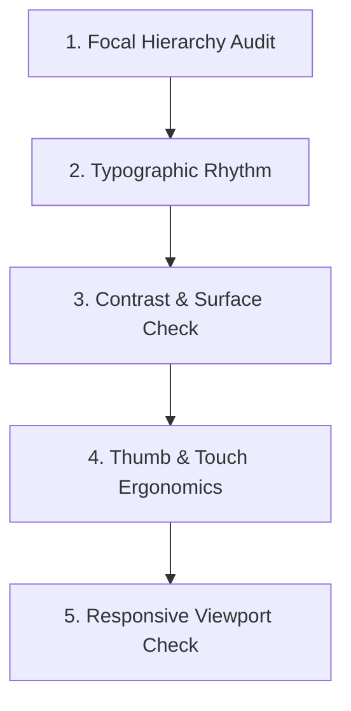

# Visual Design Critique & Anti-Slop Guide (Taste-Inspired)

This skill provides an art-direction framework and self-critique protocol to prevent coding agents from generating generic, template-driven "AI slop" (such as saturated purple gradients, identical three-card feature grids, or uninspired SaaS dashboards).

---

## 1. Anti-Slop Frontend Heuristics

1. **Reject the "Three Centered Cards" Default:** Avoid defaulted layouts where three identically sized boxes sit under a centered headline. Use asymmetric editorial layouts, vertical timelines, list-detail patterns, or deliberate hero focal points instead.
2. **No Neon / AI-Purple Gradients:** Saturated violet-to-blue gradients signal low-effort generation. Use nuanced, warm, physical-world color relationships with high legibility.
3. **Respect Content Authenticity:** Never fill prototypes or tests with fabricated Scripture, fake pious platitudes, or nonsense text. Use authentic, verified passages with proper attribution.
4. **Resist Premature Abstraction:** Do not construct a 10-layer component hierarchy for a simple row. Write clear, expressive JSX and standard Tailwind utilities.

---

## 2. Tunable Dials for Charis

Use these dial settings to calibrate interface composition:

| Dial | Setting (1–10) | Implementation Rationale |
| :--- | :---: | :--- |
| **`DESIGN_VARIANCE`** | **5 / 10** | Balanced rhythm. Consistent navigation structures paired with asymmetric editorial layout for reading and study. |
| **`VISUAL_DENSITY`** | **4 / 10** | Uncrowded and contemplative. Generous whitespace around Scripture; avoid dense dashboard tiles that create cognitive friction. |
| **`MOTION_INTENSITY`** | **2 / 10** | Quiet and restrained. Subtle opacity transitions ($150\text{--}200\text{ms}$); zero jarring bounces or distracting micro-animations. |

---

## 3. The 5-Step Visual Self-Critique Loop

Before declaring any UI design or screen implementation ready for review, run through this five-step critique:

### Step 1: Focal Hierarchy Audit
- *Question:* What is the first thing the eye rests on?
- *Rule:* On the Bible reader screen, the **Scripture text** must dominate. On the Home screen, the **featured reading / current rhythm** must lead. All secondary controls must stay subdued.

### Step 2: Typographic Rhythm
- *Question:* Does the typography feel editorial or corporate?
- *Rule:* Scripture and contemplations must render in warm serif. UI controls must render in clean sans-serif. Check that Scripture line measure never exceeds $75\text{ characters}$.

### Step 3: Contrast & Surface Check
- *Question:* Do surfaces feel layered or flat?
- *Rule:* Validate background, surface, and elevated-surface hierarchy. Ensure text passes WCAG 2.2 AA ($4.5:1$ for body, $3:1$ for large headings) in both light and dark themes.

### Step 4: Thumb & Touch Ergonomics
- *Question:* Can a user comfortably operate this with one thumb on a mobile phone?
- *Rule:* Essential actions must sit in the lower thumb zone ($\ge 44\times 44\text{px}$ targets).

### Step 5: Responsive Viewport Check
- *Question:* How does it look on a $360\text{px}$ Android phone versus a $1440\text{px}$ desktop?
- *Rule:* Mobile uses bottom navigation; desktop uses side navigation with constrained reading columns. Cards should never stretch across the entire screen on desktop monitors.
