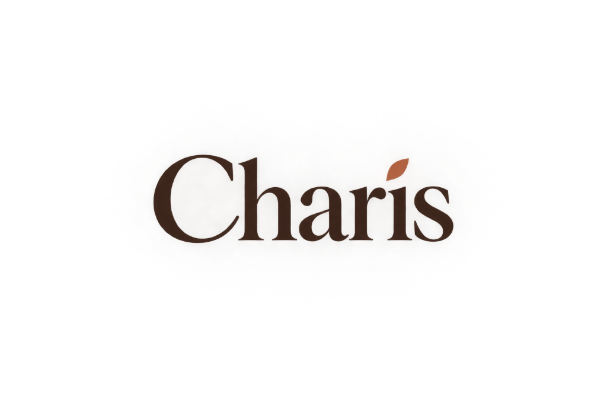
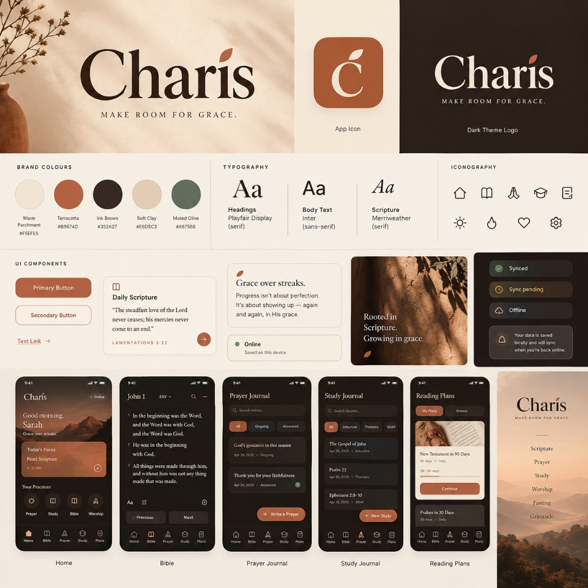

# Charis (Χάρις) · Brand Identity Foundation

**Document Version:** 1.0.0  
**Status:** Canonical Brand Specification & Architectural Reference  
**Scope:** Design tokens, logo geometry, typography, component styles, brand voice, and Tailwind implementation rules.  
**Companion Documents:** [`docs/PRD.md`](PRD.md) · [`docs/DESIGN-SYSTEM.md`](DESIGN-SYSTEM.md) · [`docs/CHARIS_UI_DESIGN_REFINEMENT_BRIEF.md`](CHARIS_UI_DESIGN_REFINEMENT_BRIEF.md)

---

## 1. Executive Summary & Brand Purpose

### 1.1 The Meaning of Charis
*Charis* (Ancient Greek: **χάρις**) represents unearned favor, divine grace, restorative kindness, and quiet, enduring beauty.

In a digital landscape crowded with loud, dopamine-driven habit trackers, invasive engagement loops, and guilt-inducing streaks, Charis stands as a **contemplative sanctuary**. It is an offline-first spiritual discipline companion crafted for personal Scripture immersion, reflective journaling, and unhurried prayer rhythm.

### 1.2 The Core Brand Anchor: Grace Over Streaks
Charis rejects punitive gamification:
* **No broken streak shaming.** A missed day is never penalized or wiped to zero; every return is met with hospitality.
* **No spiritual scoreboards.** Prayer, fasting, and Scripture reading are acts of devotion, not performance metrics.
* **Recognition through restraint.** Charis becomes unmistakable through its **warm editorial typography, harmonious natural palette, generous reading measure, and hospitable language**—not through decorative visual gimmicks.

---

## 2. Logo & Wordmark Specification



### 2.1 The Wordmark
The canonical Charis logo is a **pure serif wordmark** without a tagline.

* **Letterforms:** Elegant, high-contrast transitional editorial serif with classic Roman capital `C`, tall ascenders on `h`, open counterforms, and organic serifs.
* **The Signature Accent:** The tittle (the dot above the lowercase `i`) is replaced by an **organic leaf/olive seed motif**, angled at $+45^\circ$.
  - In light mode, the leaf is colored in signature **Terracotta** (`#B9674D` / `#D95740`), while the letterforms are set in **Deep Ink Brown** (`#352A27`).
  - In dark mode, the leaf remains **Terracotta** (`#E06D58`), while the letterforms transition to **Soft Ivory** (`#F3EFEA`).
* **Tagline Rule:** A tagline (such as *"Make Room for Grace"*) is an editorial motif, **never baked into the official logo asset**. The wordmark must stand completely alone.

### 2.2 App Icon Adaptation
* **Geometry:** Apple/Android adaptive squircle container with a smooth continuous curve radius ($22.5\%$ curvature).
* **Color:** Warm Terracotta solid background (`#B9674D` / `#D95740`).
* **Mark:** A centered, warm ivory/parchment serif lowercase `ć` or capital `C` crowned with the signature organic leaf accent hovering over the upper terminal.
* **Asset Matrix:**
  - `public/favicon.svg` (scalable vector)
  - `public/apple-touch-icon.png` ($180 \times 180\text{px}$)
  - `public/pwa-192x192.png` ($192 \times 192\text{px}$)
  - `public/pwa-512x512.png` ($512 \times 512\text{px}$)

### 2.3 Clear Space & Minimum Sizes
* **Clear Space Rule ($1x$ Rule):** Maintain an exclusion zone around all four sides of the wordmark equal to the height of the lowercase `x` in *Charis*. No borders, icons, navigation pills, or text may encroach on this zone.
* **Minimum Display Heights:**
  - **Digital Wordmark:** $22\text{px}$ minimum height (to preserve serifs and leaf clarity).
  - **Header Application:** $28\text{px} - 32\text{px}$ canonical height.
  - **App Icon Favicon:** $16\text{px}$ minimum; canonical $32\text{px}$ retina.

### 2.4 Logo Prohibitions (Brand Violations)
> [!CAUTION]
> 1. **Do NOT stretch, skew, or condense** the wordmark.
> 2. **Do NOT add drop shadows, outer glows, or gradients** to the letterforms.
> 3. **Do NOT bake a tagline** beneath the logo mark.
> 4. **Do NOT enclose the wordmark in an unapproved pill or bubble** when used in headers.
> 5. **Do NOT alter the leaf tittle's orientation** or substitute it with an ordinary circle dot.

---

## 3. Semantic Color System & Verified Contrast



### 3.1 Primary Brand Palette

| Color Name | Hex Code | HSL | Semantic Role |
| :--- | :--- | :--- | :--- |
| **Warm Parchment** | `#F5EFE5` / `#F8F2E8` | `38°, 45%, 94%` | Default light canvas background; restful on eyes |
| **Terracotta** | `#B9674D` / `#D95740` | `14°, 64%, 55%` | Primary brand accent; CTA buttons, active tabs, leaf tittle |
| **Ink Brown** | `#352A27` / `#292D3E` | `14°, 15%, 18%` | Primary high-contrast typography, structural borders |
| **Soft Clay** | `#E6D5C3` / `#F3ECE3` | `32°, 42%, 84%` | Secondary pills, subtle card surfaces, badge backgrounds |
| **Muted Olive / Sage** | `#667568` / `#78866B` | `127°, 7%, 43%` | Contemplative secondary accent; "Synced" status, calm tags |

---

### 3.2 Dual-Theme Semantic Tokens & WCAG 2.2 AA Contrast

All text and interactive color pairings achieve strict **WCAG 2.2 Level AA ($\ge 4.5:1$)** and **AAA ($\ge 7.0:1$)** contrast ratings.

#### Light Theme Tokens
```css
:root {
  color-scheme: light;
  /* Surfaces */
  --color-bg: #F8F2E8;                /* Warm Parchment base */
  --color-surface: #FFFCF7;           /* Pure devotional card surface */
  --color-surface-elevated: #FFFFFF;  /* Modals, floating steppers, dropdowns */
  
  /* Text */
  --color-text: #292D3E;              /* Deep Ink Brown (12.4:1 contrast on parchment - AAA) */
  --color-muted-text: #636A7E;        /* Muted slate-brown (4.8:1 contrast - AA) */
  
  /* Brand Accents */
  --color-primary: #D95740;           /* Terracotta CTA (4.6:1 on white - AA) */
  --color-primary-hover: #C24B36;     /* Deep terracotta for hover states */
  --color-secondary: #78866B;         /* Muted Sage (devotional secondary) */
  --color-secondary-hover: #67745B;
  
  /* Structural Borders */
  --color-border: #E8DFD4;            /* Soft organic divider */
  --color-border-subtle: #F3ECE3;     /* Ghost borders, segmented track */
  --color-card-border: rgba(217, 87, 64, 0.08);
}
```

#### Dark Theme Tokens
```css
.dark {
  color-scheme: dark;
  /* Surfaces */
  --color-bg: #13151D;                /* Deep Warm Charcoal base */
  --color-surface: #1B1E2B;           /* Elevated reading cards */
  --color-surface-elevated: #242838;  /* Modals, floating bars, dropdowns */
  
  /* Text */
  --color-text: #F3EFEA;              /* Soft Warm Ivory (14.2:1 contrast on charcoal - AAA) */
  --color-muted-text: #9EA6B8;        /* Soft Clay Text (5.4:1 contrast - AA) */
  
  /* Brand Accents */
  --color-primary: #E06D58;           /* Luminous Terracotta (5.2:1 contrast on dark surface) */
  --color-primary-hover: #E8806D;
  --color-secondary: #8E9E80;         /* Softened Sage */
  --color-secondary-hover: #9EAF8F;
  
  /* Structural Borders */
  --color-border: #2A2F42;            /* Deep slate border */
  --color-border-subtle: #1F2332;
  --color-card-border: rgba(224, 109, 88, 0.12);
}
```

---

## 4. Typography System & Scripture Reading Rules

### 4.1 Typeface Pairings
* **Headings & Display Wordmark:** Transitional Editorial Serif (`Newsreader`, `Playfair Display`, `Georgia`, `serif`).
* **Interface & Functional Controls:** Humanist Sans-Serif (`Inter`, `-apple-system`, `BlinkMacSystemFont`, `Segoe UI`, `sans-serif`).
* **Scripture Reading Surface:** Highly legible Devotional Serif (`Merriweather`, `Newsreader`, `serif`).
* **Metadata & References:** Clean Monospace (`ui-monospace`, `SFMono-Regular`, `Menlo`, `monospace`).

### 4.2 Type Scale Hierarchy

| Element | Class / Token | Size | Weight | Line Height |
| :--- | :--- | :--- | :--- | :--- |
| **Hero Greeting** | `text-3xl sm:text-4xl` | $30\text{--}36\text{px}$ | Serif Bold ($700$) | Leading Tight ($1.2$) |
| **Chapter Heading** | `text-2xl sm:text-3xl` | $24\text{--}30\text{px}$ | Serif Bold ($700$) | Leading Snug ($1.25$) |
| **Card Title** | `text-base sm:text-lg` | $16\text{--}18\text{px}$ | Serif Semibold ($600$) | Leading Normal ($1.4$) |
| **Scripture Body** | Configurable ($14\text{--}26\text{px}$) | $18\text{px}$ (default) | Serif Regular ($400$) | Leading Relaxed ($1.75$) |
| **Interface Controls** | `text-sm` | $14\text{px}$ | Sans Medium ($500$) | Leading Normal ($1.4$) |
| **Meta / Badges** | `text-xs` / `text-[11px]` | $11\text{--}12\text{px}$ | Sans Semibold ($600$) | Leading Tight ($1.2$) |

### 4.3 Scripture Reading Ergonomics
1. **The $60\text{--}75$ Character Reading Measure:**  
   Scripture text containers must be bounded by `max-w-3xl` ($768\text{px}$) and centered. Prose must never stretch endlessly across ultra-wide desktop monitors.
2. **Generous Line Height:**  
   Scripture line height is set to `leading-[1.75]` ($175\%$) to eliminate eye fatigue during deep meditation.
3. **Verse Number Superscripts:**  
   Verse numbers are rendered with `<sup>` tags in `text-xs font-sans font-bold text-charis-primary select-none mr-2`. They are excluded from clipboard copy operations.
4. **Subtle Verse Highlighting:**  
   Tapping or targeting a verse highlights the container using soft translucent tints (`bg-charis-primary/15`, `bg-charis-secondary/15`, or `bg-amber-400/20`), preserving text legibility without neon glare.

---

## 5. UI Component Styling System

### 5.1 Buttons & Interactive Controls
* **Primary Button:** Filled Terracotta (`bg-charis-primary hover:bg-charis-primary-hover text-white rounded-xl shadow-subtle min-h-[44px]`).
* **Secondary Button:** Outlined Parchment (`bg-charis-surface border border-charis-border hover:bg-charis-border-subtle text-charis-text rounded-xl min-h-[44px]`).
* **Ghost Button:** Borderless minimal (`hover:bg-charis-border-subtle text-charis-text-muted hover:text-charis-text rounded-xl min-h-[44px]`).
* **Destructive Button:** Restrained alert (`border border-red-500/30 text-red-600 dark:text-red-400 hover:bg-red-500/10 rounded-xl min-h-[44px]`).
* **Touch Target Standard:** Every interactive button, pill, and stepper enforces a minimum touch target of **$44 \times 44\text{px}$** (WCAG 2.2 Success Criterion 2.5.8).

### 5.2 Cards & Elevated Surfaces
* **Border Radii:** `rounded-2xl` ($16\text{px}$) for cards and reading surfaces; `rounded-xl` ($12\text{px}$) for inputs and inner buttons; `rounded-full` for floating stepper pills.
* **Border Weight:** Crisp $1\text{px}$ borders (`border border-charis-border`).
* **Shadows:** Restrained organic shadows:
  - `shadow-subtle`: `0 1px 3px 0 rgba(0, 0, 0, 0.05)`
  - `shadow-card`: `0 4px 6px -1px rgba(0, 0, 0, 0.04)`

### 5.3 Navigation Chrome & Restrained Glassmorphism
* **Top Header & Bottom Navigation:** Restrained glassmorphic translucency:
  ```css
  bg-charis-surface/90 backdrop-blur-md border-b border-charis-border/60
  ```
* **Solid Fallback:** On devices with `prefers-reduced-transparency: reduce` or browsers lacking backdrop-filter support, fall back gracefully to opaque `bg-charis-surface`.
* **Immersive Reading Mode:** Tapping the Scripture reading surface animates the header and floating stepper off-screen (`translate-y-full opacity-0 duration-300`), allowing distraction-free reading. Tapping again smoothly restores the chrome.

### 5.4 Honest Sync Badges & Indicators
* **Synced:** Green/Sage pill (`Synced · Saved to cloud`).
* **Sync Pending:** Amber pill (`Sync pending · X changes queuing`).
* **Offline Ready:** Slate/Parchment pill (`Offline · Saved locally`).
* **Rule:** Never display a green "Synced" indicator while offline.

---

## 6. Brand Voice & Editorial Tone (Grace Over Streaks)

### 6.1 Voice Pillars
* **Hospitable, not transactional:** Treat the user as a weary pilgrim entering a quiet garden, not an account number to retain.
* **Honest, not deceptive:** Be completely candid about sync states, download sizes, and permissions.
* **Restorative, not punitive:** A missed week is met with an open door and zero red badge warnings.

### 6.2 Copy Standards: Shaming vs. Charis

| Gamified / Shaming Copy (Prohibited) | Charis Grace-Centered Copy (Canonical) |
| :--- | :--- |
| ❌ *"Streak broken! You missed 2 days."* | ✅ *"Welcome back. Peace be with you."* |
| ❌ *"You're falling behind your reading goal!"* | ✅ *"Take your time. Scripture is a spring, not a sprint."* |
| ❌ *"Daily streak: 12 days 🔥"* | ✅ *"Days visited this month: 12"* |
| ❌ *"Keep the flame alive!"* | ✅ *"Grace upon grace. Continue when you are ready."* |
| ❌ *"Fasting complete. You burned 400 calories."* | ✅ *"Fasting rhythm concluded. May your heart be nourished."* |

---

## 7. Implementation Architecture for Tailwind & React

### 7.1 Tailwind Configuration (`tailwind.config.js`)
```javascript
export default {
  content: ["./index.html", "./src/**/*.{js,ts,jsx,tsx}"],
  darkMode: 'class',
  theme: {
    extend: {
      colors: {
        charis: {
          bg: 'var(--color-bg)',
          surface: 'var(--color-surface)',
          'surface-elevated': 'var(--color-surface-elevated)',
          text: 'var(--color-text)',
          'text-muted': 'var(--color-muted-text)',
          primary: 'var(--color-primary)',
          'primary-hover': 'var(--color-primary-hover)',
          secondary: 'var(--color-secondary)',
          border: 'var(--color-border)',
          'border-subtle': 'var(--color-border-subtle)',
          terracotta: {
            DEFAULT: '#D95740',
            dark: '#E06D58',
            light: '#F8ECE9',
          },
          sage: {
            DEFAULT: '#78866B',
            dark: '#8E9E80',
            light: '#EFF2ED',
          }
        }
      },
      fontFamily: {
        sans: ['Inter', '-apple-system', 'BlinkMacSystemFont', 'sans-serif'],
        serif: ['Newsreader', 'Playfair Display', 'Merriweather', 'Georgia', 'serif'],
      }
    }
  }
}
```

### 7.2 Cambium Structural Health Standard
To ensure the codebase remains maintainable, modular, and performant:
* **Strict Line Limit:** Every React component (`.tsx`) and module (`.ts`) must remain **$\le 300$ lines of code**. Large surfaces must be factored into subcomponents (e.g., `ScriptureReadingSurface.tsx`, `BookChapterPickerModal.tsx`, `FloatingChapterBar.tsx`).
* **Zero Secret Leakage:** No private keys or service roles in client bundles.
* **Semantic Versioning:** Strictly observe SemVer (`v1.6.1` patch $\rightarrow$ `v1.7.0` minor feature $\rightarrow$ `v2.0.0` major breaking).

---

*This document is the authoritative brand identity foundation for all Charis user interface and user experience design.*
