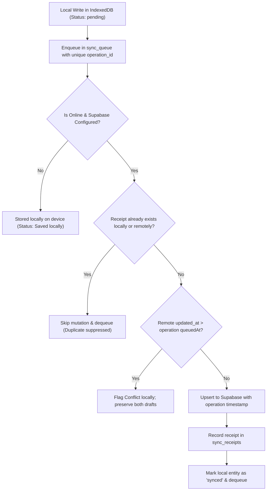

# Charis Synchronization & Server Idempotency Protocol

**Product:** Charis Spiritual Discipline PWA  
**Version:** 1.0  
**Status:** Canonical Server & Client Sync Contract (Phase 3)  
**Reference:** `docs/OFFLINE-SYNC.md` Section 6

---

## 1. Protocol Architecture Overview

Charis implements a **Transactional Direct Upsert with Idempotency Receipts & Version Gate** protocol. This protocol enables full offline capability without requiring proprietary synchronization gateways, while guaranteeing:
- **Zero Duplicate Writes:** Every client mutation is uniquely identified by an `operation_id` (UUID v4).
- **No Accidental Overwrites:** Optimistic version gating flags concurrent edits as conflicts rather than silently enforcing last-write-wins.
- **Strict Account Partitioning:** Every record and sync receipt is strictly bound to `auth.uid() = user_id`.
- **Tombstone Integrity:** Deletions record a `deleted_at` timestamp so stale devices do not resurrect deleted content upon reconnecting.



---

## 2. Idempotency Receipts

### 2.1 Receipt Structure
Both IndexedDB and Supabase PostgreSQL maintain a private `sync_receipts` table:

```sql
CREATE TABLE IF NOT EXISTS public.sync_receipts (
  operation_id UUID PRIMARY KEY,
  user_id UUID NOT NULL REFERENCES auth.users(id) ON DELETE CASCADE,
  entity_type TEXT NOT NULL,
  entity_id UUID NOT NULL,
  server_version INTEGER DEFAULT 1,
  applied_at TIMESTAMPTZ NOT NULL DEFAULT NOW()
);

ALTER TABLE public.sync_receipts ENABLE ROW LEVEL SECURITY;

CREATE POLICY "sync_receipts_own" ON public.sync_receipts
  FOR ALL
  USING (auth.uid() = user_id)
  WITH CHECK (auth.uid() = user_id);
```

### 2.2 Receipt Lifecycle
1. Before any network mutation executes, the sync engine checks if `operation_id` already exists in `sync_receipts`.
2. If the receipt exists, the operation was already committed on a previous network attempt whose response was dropped; the engine immediately marks the local entity as acknowledged and dequeues the operation.
3. If not, the mutation is executed and the receipt is written within the same transaction or batch.

---

## 3. Conflict Detection & Resolution Policy

1. **Detection:** When synchronizing an upsert for an existing record, the sync engine inspects `updated_at`. If `remote.updated_at > operation.queuedAt`, a concurrent modification occurred on another client.
2. **Preservation:** Charis **never** silently overwrites remote or local content.
3. **Representation:** The entity's local state is marked with `syncStatus: 'conflict'`, and the remote snapshot is stored in `conflictCopy`.
4. **Resolution Options:** The user is presented with calm choices in the UI:
   - *Keep this device's draft* (overrides remote with a newly enqueued operation).
   - *Accept remote version* (replaces local draft with `conflictCopy`).
   - *Combine notes* (merges both contents into a revised entry).

---

## 4. Soft-Deletion (Tombstones)

1. Deleting an item locally does **not** erase the IndexedDB row immediately if it needs to sync.
2. Instead, `deleted_at` is set to the current UTC timestamp, `syncStatus` is transitioned to `'pending'`, and a delete operation is enqueued.
3. On sync, the remote record's `deleted_at` is updated.
4. Once acknowledged, the tombstone remains for 30 days or until account cache wipe to prevent re-resurrection from older offline devices.

---

## 5. Account Switching & Sign-Out Hygiene

1. All IndexedDB stores (`prayer_entries`, `study_entries`, `sync_queue`, `sync_receipts`) index by `['userId']`.
2. All queries pass through the repository boundary filtering strictly by the active `userId`.
3. When signing out:
   - The user is notified if unsynced changes exist (`countUnsynced(userId) > 0`).
   - If clean wipe is requested, `clearUserData(userId)` purges all local records belonging to that user.
   - Another user signing in on the same browser cannot access records belonging to any other `userId`.
